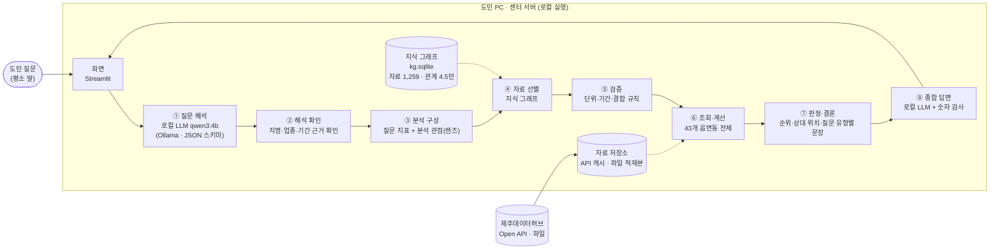
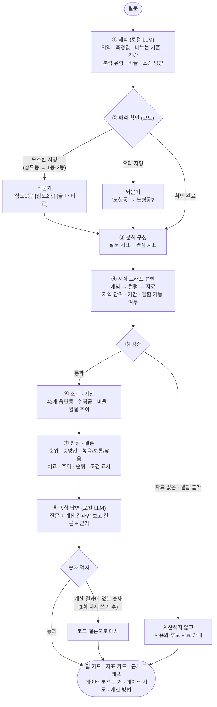
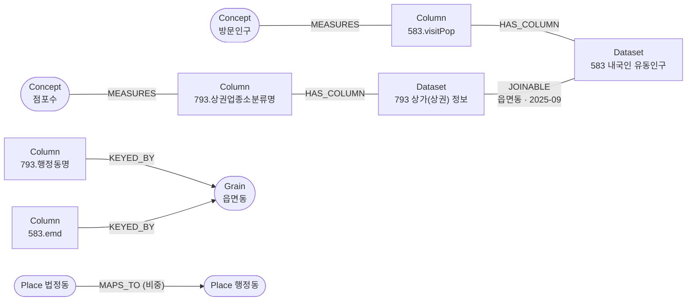

# JEJU:ON (제주온) · 제주 데이터 동네상담소

> **우리 동네 궁금한 거, 말로 물어봅서.**
> 도민이 평소 말로 물으면 **로컬 LLM**이 질문을 해석하고, **지식 그래프**가 제주데이터허브 자료 1,259종 중 필요한 자료를 골라,
> **코드**가 제주 43개 읍면동을 직접 계산하고, **로컬 LLM**이 그 결과를 쉬운 말로 답해 주는 AI Agent
>
> 제주 AI·빅데이터 활용 AI Agent 개발 챌린지 참가작

```
"애월에 카페가 너무 많을까요? 한림보다 경쟁이 심한지 궁금해요."
→ 등록 카페        애월읍 228개 · 한림읍 152개              (허브 793 상가 정보, 2025-09-18)
→ 방문 1만당 카페  애월읍 8.32곳 · 한림읍 11.41곳           (793 ÷ 583 내국인 유동인구, 같은 달)
→ 한림읍의 카페 밀집도가 더 높습니다 + 지역 비교 그래프 + 이 답변의 데이터 지도

"외국인 손님 많은 동네에서 한식당 하고 싶은데 어디가 좋을까?"
→ 외국인 방문지표 상위 25%이면서 한식 경쟁 밀도가 중앙값 이하인 곳:
  안덕면, 용담2동, 애월읍, 대천동, 조천읍 (5곳) + 조건 교차 산점도·교차표

"요즘 노형동 사람 많이 줄었어?"
→ 늘었습니다 — 노형동 일평균 방문지표 2026-03 215,945 → 2026-08 230,606 (+6.8%) + 월별 꺾은선
```

---

## 목차

1. [핵심 아이디어](#1-핵심-아이디어)
2. [전체 구조](#2-전체-구조)
3. [질문 처리 흐름](#3-질문-처리-흐름)
4. [LLM과 코드의 역할](#4-llm과-코드의-역할)
5. [지식 그래프](#5-지식-그래프)
6. [사용 데이터](#6-사용-데이터)
7. [답변 화면](#7-답변-화면)
8. [모델과 기술 스택](#8-모델과-기술-스택)
9. [평가](#9-평가)
10. [설치와 실행](#10-설치와-실행)
11. [폴더 구조](#11-폴더-구조)

---

## 1. 핵심 아이디어

| 문제 | JEJU:ON의 해결 |
|---|---|
| 제주데이터허브에는 자료가 1,259종이나 있지만, 도민은 어떤 자료를 어떻게 계산해야 할지 모른다 | 평소 말로 물으면 에이전트가 자료를 고르고 실제 데이터로 계산한다 |
| LLM에게 계산을 맡기면 숫자를 지어낼 수 있다 | **LLM은 질문 해석과 답변 작성**, 자료 선택·검증·계산·판정은 **코드**가 한다. 답변 속 숫자는 코드가 계산 결과와 대조한다 |
| 벡터 검색은 '비슷한 자료'만 찾고, 두 자료를 합칠 수 있는지는 모른다 | **지식 그래프**에 자료·컬럼·개념·지역 단위·결합 가능 관계를 담아, 함께 쓸 수 있는 조합을 찾는다 |
| 공공기관 PC에서는 외부 AI 서비스를 쓰기 어렵다 | **로컬 LLM**(Ollama · qwen3:4b)으로 해석해 질문이 외부로 나가지 않는다 |
| 숫자 하나만 보면 많은지 적은지 알 수 없다 | 제주 **43개 읍면동 전체**를 계산해 순위·중앙값·상대 위치(높음·보통·낮음)를 함께 보여 준다 |
| 특정 질문에만 맞춘 서비스는 금방 한계에 부딪힌다 | 지표를 데이터가 아니라 **개념**(점포수 ÷ 방문인구)으로 정의해, 그래프가 자료를 골라 어떤 분야 질문에도 같은 방식으로 답한다 |

**원칙: 숫자는 모두 코드가 원자료에서 계산합니다.** LLM이 쓴 답변의 숫자도 계산 결과에 있는지 확인한 뒤 보여 줍니다. 모든 지표에는 허브 자료 번호와 기준 시점이 붙고, 답변에 쓴 자료는 데이터 지도로 바로 확인할 수 있습니다.

---

## 2. 전체 구조



| 구성 | 하는 일 | 코드 |
|---|---|---|
| 화면 | 질문 입력, 답 카드, 근거 그래프, 데이터 지도, 해석 확인·고치기 | `app.py`, `tools/theme.py` |
| 질문 해석 | 로컬 LLM이 정해진 어휘 안에서 JSON으로 해석, 코드가 근거 확인 | `graph/interpret.py`, `agent/llm.py`, `agent/prompts/` |
| 분석 구성 | 질문 지표와 분석 관점(상권·창업, 인구·방문)의 관련 지표를 개념으로 구성 | `graph/pipeline.py`, `graph/lenses.yaml` |
| 자료 선별·검증·계산 | 개념 → 자료·컬럼·지역 키·필터 선택, 규칙 검증, 조회·집계 | `graph/engine.py`, `graph/kg.py` |
| 데이터 접근 | 허브 Open API(페이징·캐시·호출 한도 관리), 파일 자료 적재 | `graph/access.py` |
| 그래프 | 결과 모양에 맞는 그래프 자동 선택 | `graph/charts.py` |
| 데이터 지도 | 허브 자료 지도(첫 화면), 이 답변에 쓴 자료 지도 | `tools/data_map.py` |

---

## 3. 질문 처리 흐름



| 단계 | 담당 | 하는 일 |
|---|---|---|
| ① 질문 해석 | 로컬 LLM | 질문을 8개 항목 JSON으로 바꾼다: `places`, `concepts`(검수 개념 162개 안에서), `filters`(업종 등), `period`, `analysis`(개수·비교·추이·순위·비율 등 9종), `ratio`, `goal`(조건 방향), `unsupported`(예측처럼 답할 수 없는 요구). JSON 스키마로 출력을 강제한다 |
| ② 해석 확인 | 코드 | 모델이 낸 값이 질문에 실제로 근거가 있는지 확인한다. 지명은 행정동 이름·별칭과 대조하고, 업종은 업종 대응표·상가 자료의 업종 이름과 대조한다. 근거 없는 값은 지우고 화면에 알린다. 코드는 질문에서 낱말을 따로 뽑아 덧붙이지 않는다 |
| ③ 분석 구성 | 코드 | 질문이 직접 묻는 지표에, 질문 성격에 맞는 관점 지표를 더한다. 예: 업종이 있는 질문 → 상권·창업 관점(점포 수, 경쟁 밀도, 수요 규모, 주민 대비 점포, 외국인 비율) |
| ④ 자료 선별 | 코드 + 지식 그래프 | 개념마다 그 개념을 재는 컬럼과 자료를 찾고, 읍면동 단위로 맞출 수 있는지, 기간이 맞는지, 두 자료를 결합할 수 있는지 그래프로 확인한다. 법정동 자료는 행정동으로 변환한다 |
| ⑤ 검증 | 코드 | 아래 검증 규칙을 확인하고, 통과한 계획만 실행한다 |
| ⑥ 조회·계산 | 코드 | 허브 API는 `limit=100`으로 끝까지 페이징해 캐시하고, 파일 자료는 SQLite에서 조회한다. 43개 읍면동 전체 값을 계산한다 |
| ⑦ 판정·결론 | 코드 | 순위·중앙값·상위/하위 25% 판정을 하고, 질문 유형(비교·추이·순위·개수·조건 교차)에 맞는 결론 문장을 만든다 |
| ⑧ 종합 답변 | 로컬 LLM + 코드 | 질문과 계산 결과(사실 목록)만 LLM에 주고 질문에 대한 결론 한 문장과 근거 한 문장을 받는다. 답변 속 숫자가 계산 결과에 모두 있는지, 추천·결정 표현이 없는지 코드가 확인하고, 통과하지 못하면 계산 결과 문장을 보여 준다 |

### 검증 규칙

| 규칙 | 예 |
|---|---|
| '지표' 단위(가공 지수)는 여러 날 합산하지 않고 일평균으로 계산 | 583 방문지표 → 날짜별 합계의 평균 |
| 비율의 두 자료는 지식 그래프에서 결합 가능해야 함 | 793 상가 × 583 유동인구 → 읍면동 · 같은 달로 결합 |
| 지역 분모로 쓸 수 없는 값은 쓰지 않음 | 746 `매장수`는 업종 전체 값 → 지역 분모 사용 차단 |
| 질문 업종과 정확히 같은 값만 필터 | '카페'에 '독서실/스터디 카페'를 더하지 않음 |
| 시점 맞추기 | 상가 자료(2025-09) 기준으로 같은 달을 쓰되, 그 달이 없는 자료는 자기 최신 달로 계산하고 표시 |
| 상호·연락처 같은 식별 컬럼은 지역 키·필터로 쓰지 않음 | 업소명·전화번호 컬럼 제외 |

---

## 4. LLM과 코드의 역할

| 로컬 LLM (질문 1건에 2회: 해석 · 답변) | 코드 (항상 같은 결과) |
|---|---|
| 평소 말을 정해진 어휘의 분석 조건으로 바꾸기 ('관광객' → 방문인구, '한식당' → 업종 한식, '경쟁 덜한 곳' → 점포수 low) | 지명·업종의 근거 확인, 모호한 지명 되묻기 |
| 질문 유형 판단(비교·추이·순위·개수·비율), 답할 수 없는 요구(미래 예측·순이익) 표시 | 지식 그래프 탐색, 자료·컬럼·필터 선택, 검증 |
| 계산 결과를 읽고 질문에 대한 결론과 근거 쓰기 | 데이터 조회와 **모든 계산**, 판정, 결론 문장, 그래프 선택, 답변 숫자 검사 |

### 에이전트가 스스로 정하는 범위

| 스스로 결정 | 도민에게 되묻기 · 안내 | 하지 않음 |
|---|---|---|
| 쓸 자료와 컬럼, 집계 방법(개수·합계·평균·일평균·비율), 기준 시점, 관점 지표, 그래프 종류 | 모호한 지명(삼도동 → 삼도1동·삼도2동), 오타 지명, 해석에서 뺀 값 | 검증되지 않은 숫자 출력, 결합할 수 없는 자료 합치기, 관측 자료로 미래 예측, '어디가 좋다'는 추천·결정 |

### 해석 확인과 고치기
- 결과 맨 위 **'이렇게 이해했어요'** 줄에 모델 해석(지역 · 무엇을 · 나누는 기준 · 분석 · 기간 · 조건 방향)을 보여 줍니다.
- **'해석 고치기'**에서 지역·측정값·업종·분석 유형·경쟁 밀도·기간·조건 방향을 바꾸면 바로 다시 계산합니다.
- 선택 기능으로 **모델 재점검**(같은 모델이 질문과 1차 해석을 비교해 빠진 업종·조건 방향을 보완)을 켤 수 있습니다(`.env`의 `INTERPRET_REVIEW=on`).

---

## 5. 지식 그래프

질문에 답하려면 '비슷한 자료'가 아니라 **'같은 지역 단위와 겹치는 기간으로 합칠 수 있는 자료 조합'**이 필요합니다. 애월 카페 질문은 점포 수(793)와 방문 규모(583)를 **읍면동 단위로, 같은 달에** 합쳐야 합니다. 이 판단을 그래프의 노드·관계로 미리 계산해 두고, 운영 중에는 SQLite 파일을 조회만 합니다.

- 구축: 허브 1,259종의 메타데이터·컬럼 명세를 규칙 + GPT-5 mini 의미 태깅 + 사람 검수로 **오프라인에서 한 번** 구축 (구축 과정: [jeju-agent](https://github.com/joohayoung/jeju-agent#5-지식-그래프))
- 저장: `data/graph/kg.sqlite` (nodes · edges · 자료 제목·설명 FTS5 색인). 그래프 DB 서버 없이 파일 하나로 동작
- 운영: 로컬에서 조회만 하므로 외부 모델에 의존하지 않음



| 노드 | 수 | | 관계 | 수 |
|---|---:|---|---|---:|
| Dataset (자료) | 1,259 | | HAS_COLUMN (자료 → 컬럼) | 7,063 |
| Column (컬럼) | 7,063 | | MEASURES (컬럼 → 측정 개념) | 2,644 |
| Concept (개념, 검수 어휘 162) | 969 | | DIMENSION_OF (컬럼 → 구분 개념) | 2,051 |
| Place (지명: 읍면동 43 · 법정동 74 등) | 120 | | ABOUT (자료 → 주제 개념) | 2,927 |
| Grain (시간·공간 단위) | 17 | | KEYED_BY (컬럼 → 단위) | 2,153 |
| Category (분야) | 8 | | JOINABLE (자료 ↔ 자료, 결합 가능) | 25,461 |
| | | | MAPS_TO (법정동 → 행정동) · ROLLS_UP_TO · SAME_AS · BELONGS_TO | 81 · 128 · 77 · 1,259 |

### 분석 관점(렌즈)

지표를 데이터가 아니라 **개념**으로 적습니다. 실제 자료는 그래프가 고르므로 특정 데이터에 묶이지 않습니다(`graph/lenses.yaml`).

| 관점 | 지표(개념으로 정의) |
|---|---|
| 상권·창업 진단 | {업종} 점포 수 · 경쟁 밀도(점포수 ÷ 방문인구 × 1만) · 수요 규모(방문인구) · 주민 대비 점포(점포수 ÷ 거주인구 × 1만) · 외국인/내국인 방문 비율 |
| 인구·방문 진단 | 일평균 방문지표 · 거주지표 · 근무지표 · 외국인/내국인 방문 비율 |

새 분야(관광·환경 등)를 깊게 보고 싶으면 렌즈를 하나 더 적으면 됩니다.

---

## 6. 사용 데이터

**제주데이터허브** (허브 ID = 상세 페이지 `jejudatahub.net/data/view/data/{ID}`의 번호)

| 허브 ID | 자료 | 방식 | 쓰는 개념 · 처리 |
|---|---|---|---|
| 793 | 제주특별자치도 상가(상권) 정보 | 파일 | 점포 수(업종 소분류 필터), 2025-09-18 기준. 법정동→행정동 변환표 생성 |
| 583 | 읍면동 단위 내국인 유동인구 | API | 방문·거주·근무지표, 날짜별 합계의 일평균, 월별 추이 |
| 589 | 읍면동 단위 외국인 단기체류 유동인구 | API | 외국인 방문지표, 일평균 |
| 746 | 업종별 카드 매출과 매장수 (예비창업자 매쉬업) | 파일 | 업종별 카드이용금액(법정동 → 행정동 변환) |
| 862 | 전기자동차 충전소 정보 | API | 충전기 수 |
| 863 | 교통사고 다발지역 정보 | API | 교통사고 건수 |
| 861 | 약국 정보 | API | 의료기관(약국) 수 |
| 837 | 관광 숙박업 정보 | API | 숙박시설 수 |
| 전체 1,259종 | 허브 메타데이터·컬럼 명세 | 목록·미리보기 | 지식 그래프 구축, 데이터 지도 |

위 자료는 시연 질문에 쓰인 자료이며, 그 밖의 질문도 지식 그래프가 1,259종 중에서 같은 방식으로 자료를 고릅니다.

**프로젝트 내부 데이터**

| 파일 | 내용 |
|---|---|
| `data/graph/kg.sqlite` | 지식 그래프 |
| `data/regions.yaml` | 43개 행정동과 별칭(리·옛 이름·관광지명 → 행정동) |
| `data/industries.yaml` | 업종 대응표(질문 속 업종 → 상가·카드·음식점 자료의 실제 업종 값) |
| `graph/lenses.yaml` | 분석 관점(렌즈) |
| `graph/concept_notes.yaml` | 개념 해설(일상 말 ↔ 자료 뜻, 결론 아래 표시) |
| `data/data_map.json` | 데이터 지도용 그래프 요약 |

이용조건: 허브 자료별 제공 조건과 출처 표시를 따릅니다. 화면의 모든 지표에 허브 자료 번호와 기준 시점을 표시합니다.

---

## 7. 답변 화면

| 순서 | 구성 | 내용 |
|---|---|---|
| 0 | 이렇게 이해했어요 | 모델 해석을 칩으로 표시, '해석 고치기'로 바로 수정·재계산 |
| 1 | 답 카드 | 로컬 AI가 쓴 **결론 + 근거**("경쟁이 심한 편은 아닙니다. 연동의 치킨 경쟁 밀도는 방문 1만당 1.64곳으로 제주 43곳 중 18위(중간 수준)이기 때문입니다.") + 개념 해설 + 오래된 자료 안내. 숫자 검사를 통과하지 못하면 코드 결론을 보여 줌 |
| 2 | 질문 지표 카드 | 값 · 제주 43곳 중 순위 · 중앙값 · 높음/보통/낮음 · 출처(허브 번호·기준 시점) |
| 3 | 근거 그래프 | 결과 모양에 맞춰 코드 규칙으로 자동 선택(아래 표), 고른 이유 표시 |
| 4 | 함께 볼 지표 | 분석 관점의 관련 지표 카드(접기) |
| 5 | 데이터 분석 근거 | 지표별 사실 문장(값·순위·중앙값·출처) |
| 6 | 이 답변의 데이터 지도 | 쓴 자료(주황)·검토했지만 쓰지 않은 자료(회색, 사유)·결합 관계(선) |
| 7 | 계산 방법 · 분석 과정 기록 | 자료·컬럼·집계·필터·기준 시점, 단계별 담당(모델/코드)·소요 시간·토큰 |
| 8 | 내려받기 | HTML 보고서 · CSV |

### 그래프 자동 선택 규칙 (`graph/charts.py`)

| 결과 모양 | 그래프 |
|---|---|
| 조건 2개 교차 | 산점도(가로·세로에 지표 하나씩, 기준선, 조건에 맞는 동 강조) + 교차표 |
| 월별 추이 | 꺾은선(자료가 없는 달은 점선으로 표시) |
| 지역 2~4곳 비교 | 지표별 가로 막대 비교 |
| 일부 지역만 담은 목록형 자료 | 자료에 들어 있는 읍면동만 막대 |
| 지역 없는 '어디' 질문 | 상위 10곳 막대 |
| 지역 1곳 | 상위 15곳 + 대상 지역 막대 |
| 지표 여러 개 + 지역 | 점 분포도(43곳 중 위치를 지표별로) |

첫 화면에는 허브 1,259종을 분야별로 탐색·검색할 수 있는 **제주 데이터 지도**가 있습니다.

---

## 8. 모델과 기술 스택

| 구분 | 사용 | 용도 |
|---|---|---|
| 질문 해석·답변 모델 | **qwen3:4b** (Ollama, 로컬 실행) | 질문 → 분석 조건 JSON, 계산 결과 → 결론·근거 답변. temperature 0 · seed 고정 · thinking 끔 · JSON 스키마 강제 출력 · 검증 실패 시 1회 재시도 |
| 지식 그래프 구축 모델 | GPT-5 mini (오프라인 1회) | 자료 1,259종의 컬럼 역할·개념·단위 의미 태깅 ([jeju-agent](https://github.com/joohayoung/jeju-agent)) |
| 언어 | Python 3.10+ | 전체 |
| 화면 | Streamlit | 웹 화면 |
| 그래프 | Plotly | 근거 그래프 |
| 네트워크 시각화 | vis-network 9.1.13 (`tools/vendor/`에 포함, 인터넷 없이 동작) | 데이터 지도 |
| 데이터 처리 | pandas | 집계·순위 |
| 출력 검증 | pydantic v2 | LLM 출력 스키마(어휘 목록으로 실행 중 생성) |
| 저장소 | SQLite (FTS5) | 지식 그래프, API 캐시, 파일 자료 적재본 |
| 설정 | PyYAML | 렌즈·지명·업종·개념 해설 |
| 데이터 원천 | 제주데이터허브 Open API · 파일 | 허브 자료 조회 |
| 시험 | pytest | 오프라인 시험 21개 |

**개발·시연 환경**: Windows, AMD Ryzen 9 3900X · RAM 32GB · NVIDIA RTX 2070 SUPER. 질문 해석은 중앙값 약 3.6초입니다.

---

## 9. 평가

### 모델 해석 정확도 (`scripts/eval_interpret.py`)

질문을 로컬 모델로 해석해 지명·개념·구분값·분석 유형이 정답과 맞는지 잽니다.

| 평가 세트 | 문항 | 지명 | 개념 | 구분값 | 분석 유형 | 전체 | 응답 시간(중앙값) |
|---|---:|---:|---:|---:|---:|---:|---:|
| 개발 세트 `eval/interpret_cases.jsonl` | 44 | 100% | 98% | 98% | 100% | **95%** | 3.5초 |
| 확인 세트 `eval/interpret_holdout.jsonl` (프롬프트 수정에 쓰지 않은 질문) | 15 | 100% | 93% | 100% | 93% | **87%** | 3.6초 |

개발 세트 구성: 개수 6 · 밀도·경쟁 6 · 비교 6 · 추이 5 · 순위 5 · 생활시설 6 · 답할 수 없는 요구 4 · 잡담 2 · 오타·모호 지명 4.
운영 규칙: 프롬프트를 바꿀 때마다 평가를 돌리고, 틀린 유형은 코드가 아니라 **프롬프트 예시**로 고칩니다.

### 계산 시험 (`tests/test_graph.py`, 오프라인 21개)

| 확인 내용 | 기대값 |
|---|---|
| 애월·한림 카페 수, 방문 1만당 카페 | 228 · 152, 8.32 · 11.41 |
| 한림읍 편의점 수 | 59 |
| 2026-08 노형동·연동 일평균 방문지표 | 230,606.48 · 246,548.48 |
| '지표' 단위 합산 차단, 746 매장수를 지역 분모로 쓰지 않음 | 차단 |
| 다른 자료 시점과 맞지 않는 자료는 자기 최신 달로 계산 | 746 → 2021-05 |
| 질문 유형별 결론(비교·추이), 개념 해설, 그래프 자동 선택 | 통과 |
| 개수 질문의 관점 지표 수 제한, 오래된 자료 안내, 모호한 지명 되묻기, 조건 2개 교차 | 통과 |
| 질문에 근거 없는 값 제거, 업종이 아닌 값 제거, 모델 재점검 반영 | 통과 |
| 종합 답변 숫자 검사(계산 결과에 없는 숫자가 있으면 대체) | 통과 |

```
.venv\Scripts\python -m pytest -q tests
```

---

## 10. 설치와 실행

### 요구 사항
- Python 3.10 이상
- [Ollama](https://ollama.com) 와 qwen3:4b

```
ollama pull qwen3:4b
```

### 설정 (`.env`)

`.env.example`을 `.env`로 복사해 값을 채웁니다(`.env`는 커밋하지 않음).

| 변수 | 설명 |
|---|---|
| `HUB_PROJECT_KEY` | 제주데이터허브 프로젝트 키 (허브에서 사용할 자료를 '프로젝트 담기' 해야 API 호출 가능) |
| `OLLAMA_MODEL` | 해석 모델 (기본 `qwen3:4b`) |
| `LLM_MODE` | `on`(기본) / `off` |
| `GRAPH_OFFLINE` | `1`이면 허브 API를 부르지 않고 저장된 자료만 사용 (시연·시험) |
| `INTERPRET_REVIEW` | `on`이면 모델 재점검 사용 (기본 `off`) |

### 실행 (Windows)

```
run.bat
```

처음 실행 때 가상환경과 패키지를 설치하고, 브라우저에서 http://localhost:8501 이 열립니다. 직접 실행할 때:

```
python -m venv .venv
.venv\Scripts\python -m pip install -r requirements.txt
.venv\Scripts\streamlit run app.py
```

macOS·Linux는 `run.sh`를 씁니다.

### 자료 준비
- **API 자료**: 처음 조회할 때 허브에서 43개 읍면동을 받아 `data/graph/api_cache.sqlite`에 저장하고, 이후에는 저장본으로 바로 답합니다. 시연 질문의 자료를 미리 받아 두려면:

  ```
  .venv\Scripts\python scripts\precache_demo.py
  ```

- **파일 자료**: 허브에서 내려받아 `data/graph/raw/hub<허브ID>_이름.csv`로 두면 처음 조회 때 자동으로 `data/graph/file_cache.sqlite`에 적재합니다(예: `hub793_상가.csv`, `hub746_카드.csv`).

### 모델 해석 평가

```
.venv\Scripts\python scripts\eval_interpret.py --no-review
.venv\Scripts\python scripts\eval_interpret.py --no-review --cases eval/interpret_holdout.jsonl
```

---

## 11. 폴더 구조

```
.
├── app.py                         화면 (Streamlit)
├── run.bat / run.sh               실행
├── requirements.txt
├── .env.example                   설정 예시 (실제 키는 .env, 커밋 금지)
├── agent/
│   ├── llm.py                     Ollama 호출: JSON 스키마 강제, 재시도, 측정 로그
│   └── prompts/
│       ├── graph_interpret.md     질문 해석 지시문
│       ├── graph_answer.md        종합 답변 지시문
│       └── graph_review.md        모델 재점검 지시문 (선택)
├── graph/
│   ├── interpret.py               ① 해석 + ② 해석 확인 (지명·업종·기간 근거, 모호한 지명 되묻기)
│   ├── narrate.py                 ⑧ 종합 답변 (계산 결과 → 로컬 LLM 답변, 숫자 검사)
│   ├── pipeline.py                ③ 분석 구성 · ⑦ 판정 · 질문 유형별 결론 · 조건 교차
│   ├── engine.py                  ④ 자료 선별 · ⑤ 검증 · ⑥ 조회·집계
│   ├── kg.py                      지식 그래프 조회
│   ├── access.py                  허브 Open API · 파일 자료 접근, 캐시, 호출 한도
│   ├── charts.py                  근거 그래프와 자동 선택 규칙
│   ├── lenses.yaml                분석 관점(렌즈)
│   └── concept_notes.yaml         개념 해설
├── tools/
│   ├── data_map.py                제주 데이터 지도 · 이 답변의 데이터 지도
│   ├── rank_areas.py              순위·상대 위치 계산
│   ├── theme.py                   화면 디자인
│   └── vendor/                    vis-network (라이선스 포함)
├── data/
│   ├── graph/kg.sqlite            지식 그래프
│   ├── data_map.json              데이터 지도 요약
│   ├── regions.yaml               행정동·별칭
│   └── industries.yaml            업종 대응표
├── eval/                          모델 해석 평가 세트 (개발 44 · 확인 15)
├── scripts/
│   ├── precache_demo.py           시연 자료 미리 받기
│   ├── eval_interpret.py          모델 해석 평가
│   ├── check_interpret.py         질문 몇 개 해석 확인
│   └── build_data_map.py          데이터 지도 요약 생성
└── tests/test_graph.py            오프라인 시험 21개
```

레포에 넣지 않은 것: `.env`(허브 키), 허브 API 캐시·파일 자료 적재본·원자료(`data/graph/api_cache.sqlite`, `file_cache.sqlite`, `raw/` — 허브에서 다시 받을 수 있고 용량이 큼).
